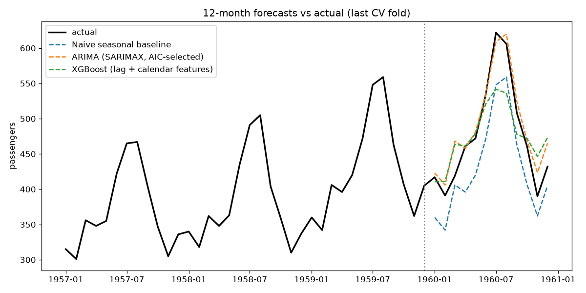

# Time-Series Forecasting System — Report

## Dataset
Monthly international airline passengers, Jan 1949 – Dec 1960 (144 months),
a public benchmark demand series (bundled at `data/airline-passengers.csv`,
source: https://raw.githubusercontent.com/jbrownlee/Datasets/master/airline-passengers.csv).
The series has a strong upward trend plus a yearly seasonal cycle (summer peaks).

## Models
1. **Naive seasonal baseline** — forecasts each future month as the same month
   one year earlier (the honest "do nothing smart" reference point).
2. **ARIMA (statistical)** — SARIMAX; the (p,d,q)×(P,D,Q,12) order is chosen per
   training fold by AIC from a small grid, so trend + yearly seasonality are
   modelled explicitly.
3. **XGBoost (machine learning)** — 400 trees on engineered features: lags 1–12,
   rolling means (3/6/12 months), month as sin/cos, and a linear time index.
   Multi-step forecasts are recursive (each predicted month feeds the next).

## Evaluation — time-based cross-validation, not random splits
Random splits would let the model train on the future and test on the past.
Instead: 3 expanding-window folds, each forecasting the next 12 months
(train →108 / test 108–120, train →120 / test 120–132, train →132 / test 132–144).
Metric reported is the mean over folds.

| Model | MAE | RMSE |
|---|---|---|
| Naive seasonal baseline | 35.92 | 38.99 |
| ARIMA (SARIMAX, AIC-selected) **(winner)** | 26.58 | 29.61 |
| XGBoost (lag + calendar features) | 32.93 | 38.54 |



## Why ARIMA won
- The series is dominated by two smooth, global patterns — a steady trend and a
  stable yearly season. ARIMA's differencing + seasonal terms capture exactly
  that structure with a handful of parameters, so it generalises across folds.
- The naive baseline copies last year's level but ignores the trend, so it
  under-predicts every fold as passenger numbers keep climbing.
- XGBoost learns local lag patterns well, but with only 144 months the trees
  cannot extrapolate the rising trend beyond the levels seen in training —
  a known weakness of tree models on trending series. Its recursive forecasts
  also accumulate error month by month, while ARIMA's seasonal structure stays
  anchored.

## Serving
The winning ARIMA model, refit on all 144 months, is served by the FastAPI app
(`src/api.py`): `GET /health`, `GET /info`, `POST /forecast {"periods": 12}`.
Example 12-month forecast (1961): Jan 447 … Jul 649 (peak) … Dec 465 —
continuing the trend and seasonal shape of the 1950s.

## Reproduce
```
python -m venv .venv && .venv/bin/pip install -r requirements.txt
.venv/bin/python -m src.cli train     # CV, winner, artifact, results/
.venv/bin/python -m pytest tests/ -q  # 13 tests
.venv/bin/python -m src.cli serve     # API on http://127.0.0.1:8000
```
